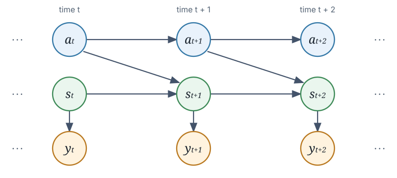

# Two-state activity model

The optional activity model allows the animal to switch between `slow` and
`fast` movement. Let ``s_t`` be its position, ``a_t \in \{\mathrm{slow},
\mathrm{fast}\}`` its activity, and ``y_t`` the observations at time ``t``.
The filter and smoother operate on the joint position and activity state
``(s_t, a_t)``.



Activity at time ``t`` controls movement to time ``t + 1``. Observations
depend on position, but not directly on activity.

## Model

The `transition_matrix` describes changes in activity:

```math
T_{a,a'} = \Pr(a_{t+1}=a' \mid a_t=a).
```

Its rows are the previous activity and its columns are the next activity, both
ordered `[slow, fast]`. Each row therefore sums to one.

Each activity has its own movement transition:

```math
q_a(s' \mid s) = \Pr(s_{t+1}=s' \mid s_t=s, a_t=a).
```

Wahoo applies this transition by convolution with the activity-specific
kernel `H[a]`. The kernels are constructed from the two values in
`movement_std = (slow, fast)`, using the diffusion coefficient
``D_a = \sigma_a^2/2`` for movement standard deviation ``\sigma_a``.

The activity change and movement are conditionally independent given the
current state. The joint transition is therefore

```math
\Pr(s_{t+1}=s', a_{t+1}=a' \mid s_t=s, a_t=a)
    = q_a(s' \mid s) T_{a,a'}.
```

This equation also makes the timing convention explicit: the movement from
``s_t`` to ``s_{t+1}`` uses the activity at time ``t``, even if the activity
switches at time ``t+1``.

The observation models provide the likelihood

```math
p(y_t \mid s_t).
```

Conditional on position, the observations do not depend directly on activity.

## Filtering

Let the filtered joint distribution be

```math
f_t(s,a) = \Pr(s_t=s, a_t=a \mid y_{1:t}).
```


Given the initialized distribution ``f_1(s,a)`` the following
recursions give the later the joint state:

```math
f_t^-(s',a') = \sum_a T_{a,a'} \sum_s q_a(s' \mid s) f_{t-1}(s,a).
```

Then observation model is applied and normalized:

```math
f_t(s,a) =
\frac{p(y_t \mid s) f_t^-(s,a)}
     {\displaystyle\sum_{a'}\sum_{s'}p(y_t \mid s') f_t^-(s',a')}.
```

Position and activity are propagated jointly because they generally become
dependent after observations are applied.

## Smoothing and outputs

The smoother uses all observations to obtain
``g_t(s,a) = \Pr(s_t=s,a_t=a \mid y_{1:T})``. Its backward update is

```math
g_t(s,a) \propto f_t(s,a)
\sum_{a'}\sum_{s'} T_{a,a'}q_a(s' \mid s)
\frac{g_{t+1}(s',a')}{f_{t+1}^-(s',a')}.
```

The public results are marginals of these joint distributions:

```math
\begin{aligned}
\mathtt{pos\_filter}(s,t) &= \sum_a f_t(s,a),\\
\mathtt{pos\_smoother}(s,t) &= \sum_a g_t(s,a),\\
\mathtt{activity}(a,t) &= \sum_s f_t(s,a).
\end{aligned}
```

Thus `activity` contains the filtered probabilities of `[slow, fast]`, while
`pos_smoother` contains the activity-marginalized smoothed position
distribution.
